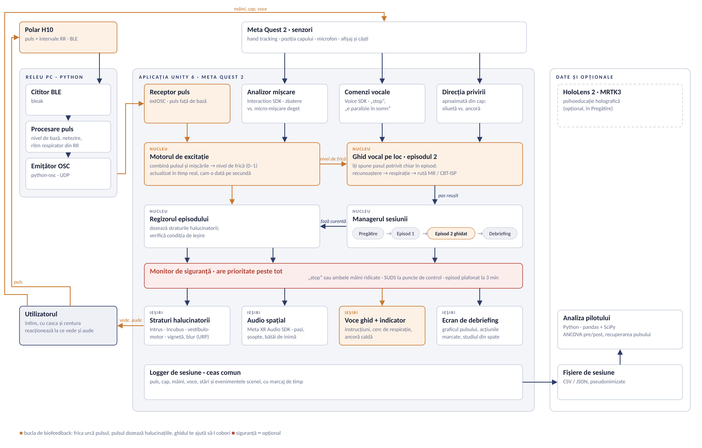

# JOJO

**Sleep Paralysis: Simulated Episode and Evidence-Based Coping Training**

JOJO este o aplicație VR pe Meta Quest 2 care simulează un episod de paralizie în somn și te învață ce să faci în timpul lui. Episodul se termină doar când pulsul tău scade sau când miști un deget. Testăm într-un studiu pilot dacă simularea te învață mai mult decât un text sau un video.

Proiect pentru cursul *Introduction to Mixed Realities*.

## Documente

- [Tema 4 – State of the art](Tema4_State_of_the_art_JOJO.docx)

## Diagrama de componente

Sesiunea are patru etape: **Pregătire → Episod 1 → Episod 2 ghidat → Debriefing**. În episodul 2, ghidul vocal te îndrumă pe loc, în timpul episodului.

Componentele portocalii formează bucla de biofeedback: frica îți urcă pulsul, pulsul face halucinațiile mai puternice, iar ghidul te ajută să-l cobori. Monitorul de siguranță poate opri episodul oricând.

## Tehnologii

Unity 6 + URP · Meta XR Interaction SDK · Meta Voice SDK · Meta XR Audio SDK · Polar H10 · Python (bleak, python-osc) · extOSC
